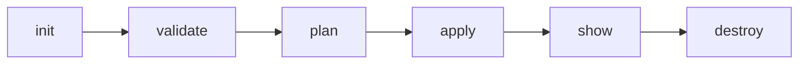

# 🪣 Day 03: My First S3 Bucket, Built with Code

> *Clicking through the AWS console is easy. Making AWS do what you say from a text file? That's where it gets fun.*


Part of the **#30DaysOfAWSTerraform** challenge by [Piyush Sachdeva](https://www.linkedin.com/in/piyushsachdeva/). Day 3 is where Terraform stops being theory and starts creating real cloud resources.

---

## 🎯 What I Learned Today

- 🔐 How AWS **authentication & authorization** actually works
- 🪣 Creating and managing an **S3 bucket** purely through Terraform
- 🔁 The core Terraform loop: `init → validate → plan → apply → destroy`

---

## 🧰 Before You Start

### 1. An AWS account
No account yet? Grab the [AWS Free Tier](https://aws.amazon.com/free/).

### 2. The AWS CLI
First, check your machine's architecture so you download the right installer:

```bash
# Linux / macOS
uname -m

# Windows PowerShell
$env:PROCESSOR_ARCHITECTURE
```

<details>
<summary><b>🪟 Windows</b></summary>

```powershell
# winget (recommended)
winget install Amazon.AWSCLI

# or Chocolatey
choco install awscli
```
</details>

<details>
<summary><b>🍎 macOS</b></summary>

```bash
# Homebrew
brew install awscli

# or the official installer
curl "https://awscli.amazonaws.com/AWSCLIV2.pkg" -o "AWSCLIV2.pkg"
sudo installer -pkg AWSCLIV2.pkg -target /
```
</details>

<details>
<summary><b>🐧 Ubuntu / Debian (x86_64)</b></summary>

```bash
sudo apt update
curl "https://awscli.amazonaws.com/awscli-exe-linux-x86_64.zip" -o "awscliv2.zip"
unzip awscliv2.zip
sudo ./aws/install
aws --version
```
</details>

<details>
<summary><b>🐧 Ubuntu / Debian (ARM64)</b></summary>

```bash
curl "https://awscli.amazonaws.com/awscli-exe-linux-aarch64.zip" -o "awscliv2.zip"
unzip awscliv2.zip
sudo ./aws/install
```
</details>

---

## 🔑 Teaching Terraform Who You Are

Terraform can't touch AWS until AWS knows who's asking. Here are four ways to introduce yourself:

| # | Method | Best for |
|---|--------|----------|
| 1 | `aws configure` | Local learning (what I used) ⭐ |
| 2 | Environment variables | CI pipelines, quick tests |
| 3 | IAM Roles | EC2 & AWS services, the gold standard 🏆 |
| 4 | Named profiles | Juggling multiple accounts |

**Method 1: AWS CLI configuration**
```bash
aws configure
```
You'll be asked for your Access Key ID, Secret Access Key, default region (e.g. `us-east-1`) and output format (`json`).

**Method 2: Environment variables**
```bash
export AWS_ACCESS_KEY_ID="your-access-key"
export AWS_SECRET_ACCESS_KEY="your-secret-key"
export AWS_DEFAULT_REGION="us-east-1"
```

**Method 3: IAM Roles**
Attach a role directly to your EC2 instance or AWS service. No keys to store, nothing to leak. This is the best practice.

**Method 4: Named profiles**
```bash
aws configure --profile dev
export AWS_PROFILE=dev
```

---

## 🏗️ The Terraform Code

### Provider setup: `main.tf`

```hcl
terraform {
  required_providers {
    aws = {
      source  = "hashicorp/aws"
      version = "~> 6.0"
    }
  }
}

provider "aws" {
  region = "us-east-1"
}
```

### The bucket

```hcl
resource "aws_s3_bucket" "my_bucket" {
  bucket = "your-unique-bucket-name-day03"   # must be globally unique!

  tags = {
    Name        = "Day03-S3-Bucket"
    Environment = "Learning"
    Challenge   = "30DaysOfAWSTerraform"
  }
}
```

> ⚠️ **Heads up:** bucket names are unique across *every AWS account on Earth*. `my-bucket` is definitely taken. Get creative.

---

## 🔄 The Terraform Workflow



```bash
terraform init       # 1. Download the provider plugins
terraform validate   # 2. Catch syntax mistakes before AWS ever sees them
terraform plan       # 3. Preview what's about to happen
terraform apply      # 4. Make it real: bucket created! 🎉
terraform show       # 5. Inspect the current state
terraform destroy    # 6. Clean up (your wallet will thank you)
```

---

## 🎬 Watch It Come Alive

Reading commands is one thing. Watching the bucket appear in the console is another. Here's the video walkthrough that this day is based on, where the whole thing goes from empty folder to live S3 bucket:

<p align="center">
  <a href="https://www.youtube.com/watch?v=09HQ_R1P7Lw&t=357s">
    
  </a>
  <br>
  <sub>▶️ <a href="https://www.youtube.com/watch?v=09HQ_R1P7Lw&t=357s"><b>[3/30] Create an AWS S3 Bucket Using Terraform (it's simple)</b></a></sub>
</p>

---

## 📁 Project Structure

```
day03/
├── main.tf               # Provider + S3 bucket resource
├── README.md             # You are here 👋
└── .terraform.lock.hcl   # Provider version lock (commit this to Git)
```

---

## 💡 Key Takeaways

1. **Credentials first.** Terraform can't call AWS APIs until they're configured.
2. **IAM Roles beat static keys.** No keys stored anywhere means nothing to steal.
3. **Bucket names are global**, across every account and every region.
4. **`terraform validate` is a free safety net**, catching errors before any API call.
5. **Always `terraform destroy` after practice.** Forgotten resources become surprise bills.

---

## 📌 Quick Reference

| Topic | Detail |
|-------|--------|
| **Bucket naming** | Lowercase, 3–63 characters, globally unique, no underscores |
| **Region** | Make sure it matches where you intend to deploy |
| **Free Tier** | S3 has historically included 5 GB storage, 20,000 GET and 2,000 PUT requests/month. Terms change, so check the current [Free Tier page](https://aws.amazon.com/free/) |
| **Cleanup** | `terraform destroy` when done, since storage costs add up |
| **Credentials** | Never commit `~/.aws/credentials` or hardcode keys in `.tf` files 🚫 |

---

## 🩹 When Things Go Wrong

| Error | Fix |
|-------|-----|
| `No valid credential sources found` | Run `aws configure` or export the environment variables |
| `BucketAlreadyExists` | Someone has your name. Pick a more unique one |
| `Invalid region` | Check the `region` in your `provider "aws"` block |
| `AccessDenied` | Your IAM user/role needs the `s3:CreateBucket` permission |

---

## 📚 Resources

- [Terraform AWS S3 Docs](https://registry.terraform.io/providers/hashicorp/aws/latest/docs/resources/s3_bucket)
- [AWS CLI Installation](https://docs.aws.amazon.com/cli/latest/userguide/getting-started-install.html)
- [AWS Free Tier](https://aws.amazon.com/free/)
- [S3 Bucket Naming Rules](https://docs.aws.amazon.com/AmazonS3/latest/userguide/bucketnamingrules.html)

---

## ⏭️ Up Next

**Day 04: Terraform State File Management.** Remote backends with S3 + DynamoDB for state locking. Today's bucket is about to get a very important job. 👀

---

<p align="center">
  <b>Day 03 of 30</b> · Building in public 🚀<br>
  Follow the journey on <a href="https://www.linkedin.com/in/austin-joseph-686629327/">LinkedIn</a>
</p>

<p align="center">
  <b>Day 03 of #30daysofawsterraform 🚀</b>
</p>
